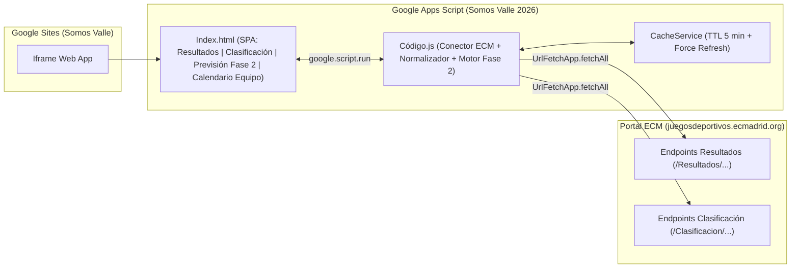

# Plan de Desarrollo Agéntico: Somos Valle 2026 (Seguimiento Liga ECM)

## 1. Objetivo del Proyecto
Desarrollar y desplegar una **Web App en Google Apps Script** (embebible en **Google Sites**) que replique y mejore el diseño de **Somos Valle** (`https://sites.google.com/view/somosvalle/resultados-fase-1`), obteniendo en tiempo real los datos de **Resultados** y **Clasificación** desde el portal oficial de **Escuelas Católicas de Madrid (ECM)** para todos los grupos de la categoría, con seguimiento especial al equipo **El Valle Sanchinarro B**, navegación interactiva al calendario de cada equipo y simulación en vivo de la **Previsión de Fase 2**.

### Parámetros de la Competición
- **Organizador:** Escuelas Católicas de Madrid (ECM)
- **Deporte:** Fútbol Sala
- **Competición / Categoría:** Prebenjamín Mixto
- **Alcance:** Todos los grupos y jornadas de la liga (descubrimiento dinámico de Grupos 1..6 y Jornadas 1..N)
- **Equipo destacado (por defecto):** `El Valle Sanchinarro B`

---

## 2. Arquitectura de la Solución

---

## 3. Especificación Funcional de Vistas y Navegación

La aplicación contará con una barra de navegación principal (además de soporte por parámetro URL `?tab=...` por si se desea enlazar directamente a una sección) con **3 secciones principales** y **1 vista transversal de Calendario de Equipo**:

### 3.1. Sección "Resultados"
- **Selector de Grupo (Grupos 1 a 6):** Se abre **por defecto en el grupo de `El Valle Sanchinarro B`**, mostrando una insignia/estrella en la pestaña de su grupo.
- **Selector de Jornada (Jornadas 1 a N):** Detecta y selecciona por defecto la jornada actual (la última con resultados o la próxima a disputarse).
- **Tarjetas de Partido (Diseño Somos Valle):**
  - Marcador central destacado en **rojo** para partidos disputados (y fecha/hora/campo para partidos pendientes o en juego).
  - Resaltado visual especial en la tarjeta del partido de `El Valle Sanchinarro B`.
  - **Nombres de equipo interactivos (clicables):** Al pulsar en cualquier equipo (local o visitante), navega directamente al **Calendario completo de ese equipo**.

### 3.2. Sección "Clasificación"
- **Selector de Grupo (Grupos 1 a 6):** Sincronizado con el grupo activo (por defecto el de `El Valle Sanchinarro B`).
- **Tabla de Clasificación completa:**
  - Columnas: Posición (`Pos`), Equipo, Puntos (`Pts`), `PJ`, `PG`, `PE`, `PP`, `GF`, `GC`, `Dif` y **Destino virtual en Fase 2** (badge indicando a qué grupo de Fase 2 iría hoy según su posición/rendimiento).
  - Fila de `El Valle Sanchinarro B` destacada visualmente.
  - **Equipos clicables:** Pulsar sobre cualquier fila o nombre de equipo abre su **Calendario completo**.

### 3.3. Sección "Previsión de Fase 2" (Simulador en Tiempo Real)
Calcula y muestra las **6 tablas virtuales de los grupos de la 2ª Fase** (que comienza el 21 de febrero y acaba el 9 de mayo, a una vuelta) usando en vivo las clasificaciones actuales de la Fase 1 y arrastrando los datos actuales de cada equipo (Grupo de origen en Fase 1, Puesto en Fase 1, `Pts`, `PJ`, `PG`, `PE`, `PP`, `GF`, `GC`, `Dif`) para ver de un vistazo el nivel de los rivales que tocarían hoy.

#### Reglas de Asignación de Grupos de Fase 2 (según `fase2-reglas.png`)
| Grupo en Fase 2 | Puestos Globales | Equipos que lo componen (6 grupos en Fase 1) | Total Equipos |
| :--- | :---: | :--- | :---: |
| **Grupo Fase Final** | **1º al 10º** | • El **1º** de cada grupo (6) • Los **4 mejores 2º** (4) | **10 equipos** |
| **Grupo 1 Fase Igualatoria** | **11º al 20º** | • Los **2 peores 2º** (2) • El **3º** de cada grupo (6) • Los **2 mejores 4º** (2) | **10 equipos** |
| **Grupo 2 Fase Igualatoria** | **21º al 30º** | • Los **4 peores 4º** (4) • El **5º** de cada grupo (6) | **10 equipos** |
| **Grupo 3 Fase Igualatoria** | **31º al 40º** | • El **6º** de cada grupo (6) • Los **4 mejores 7º** (4) | **10 equipos** |
| **Grupo 4 Fase Igualatoria** | **41º al 49º** | • Los **2 peores 7º** (2) • El **8º** de cada grupo (6) • El **mejor 9º** (1) | **9 equipos** |
| **Grupo 5 Fase Igualatoria** | **50º al 58º** | • Los **5 peores 9º** (5) • El **10º** de cada grupo (4) | **9 equipos** |

- **Criterio de desempate entre grupos** (para determinar mejores/peores 2º, 4º, 7º y 9º):
  1. Mayor puntuación (`Pts`) — *con opción de conmutar/considerar coeficiente `Pts / PJ` si algún grupo tiene distinto número de partidos jugados*.
  2. Mayor diferencia de goles (`GF - GC`).
  3. Mayor número de goles a favor (`GF`).
  4. Menor número de goles en contra (`GC`).
- **Experiencia en la vista "Previsión de Fase 2":**
  - Se posiciona o resalta automáticamente el grupo de Fase 2 donde estaría clasificado hoy **`El Valle Sanchinarro B`**.
  - Cada tabla muestra los equipos ordenados con sus estadísticas de Fase 1, su medalla de procedencia (ej. `2º Grupo 3`) y permite hacer clic en cualquier equipo para ir a su **Calendario**.

### 3.4. Vista "Calendario de Equipo" (Navegación Recursiva entre Equipos)
- Accesible haciendo clic en **cualquier equipo** desde:
  - Una tarjeta de partido en **Resultados**
  - Una fila de **Clasificación**
  - Una fila de **Previsión de Fase 2**
  - **Otro partido dentro del propio Calendario de Equipo** (si estoy viendo el calendario del Equipo A y pulso sobre su rival Equipo B en la Jornada 5, navego inmediatamente al calendario del Equipo B).
- **Contenido de la ficha del equipo:**
  - Cabecera con nombre del equipo, grupo actual, posición actual, puntos, balance de goles (`GF`/`GC`) y grupo proyectado en Fase 2.
  - Botón rápido en cabecera para **"Ver El Valle Sanchinarro B"** y botón **"Volver"**.
  - **Listado cronológico de todas las jornadas (Jugadas y Pendientes):**
    - Partidos ya jugados: muestran el marcador en rojo e indicador visual de **Victoria (V - verde)**, **Empate (E - ámbar)** o **Derrota (D - rojo)** desde la perspectiva del equipo consultado.
    - Partidos pendientes: muestran fecha, hora, campo/instalación y la posición actual del rival en la tabla para anticipar la dificultad de lo que le queda por jugar.

---

## 4. Fases de Ejecución Autónoma

### Fase 1: Reconocimiento de la Web de Referencia ("Somos Valle")
1. Navegar por `https://sites.google.com/view/somosvalle/resultados-fase-1` y sus secciones para extraer estilos exactos, tipografías, colores, estructura de tarjetas y cabeceras.

### Fase 2: Ingeniería Inversa de los Endpoints de ECM
1. Inspeccionar el tráfico XHR/Fetch en `https://juegosdeportivos.ecmadrid.org/Resultados/ResultadosTemporada` y `https://juegosdeportivos.ecmadrid.org/Clasificacion/ClasificacionTemporada`.
2. Simular la selección de **Deporte: Fútbol Sala** y **Competición: Prebenjamín Mixto** y descubrir dinámicamente todos los grupos y jornadas activos.
3. Identificar URLs internas, métodos (`GET`/`POST`), payloads y estructura de respuesta para construir el parser y normalizador en Apps Script.

### Fase 3: Creación del Proyecto con `clasp`
1. Ejecutar `clasp create --type webapp --title "Somos Valle 2026"`.
2. Configurar `appsscript.json` con zona horaria `Europe/Madrid`, permisos de `UrlFetchApp` y acceso público (`ANYONE_ANONYMOUS`).

### Fase 4: Desarrollo del Backend (`Código.js`)
1. Implementar el descubrimiento dinámico y descarga paralela (`UrlFetchApp.fetchAll`) de clasificaciones y resultados de todas las jornadas de todos los grupos.
2. Implementar la capa de caché en `CacheService` (TTL de 5 minutos) con soporte para `forceRefresh`.
3. Implementar el normalizador de partidos, clasificaciones, calendarios por equipo y el motor de cálculo de **Previsión de Fase 2**.
4. Exponer `doGet(e)` con `XFrameOptionsMode.ALLOWALL` para Google Sites.

### Fase 5: Desarrollo del Frontend (`Index.html`)
1. Maquetar la interfaz con la estética de **Somos Valle** (pestañas de Grupo 1..N, selector de Jornadas, tarjetas de partido con marcador en rojo).
2. Construir las vistas de **Resultados**, **Clasificación**, **Previsión de Fase 2** y **Calendario de Equipo** con navegación fluida entre equipos al hacer clic.
3. Configurar la selección automática inicial en el grupo de **El Valle Sanchinarro B**.

### Fase 6: Despliegue y Entrega (`clasp push` & `clasp deploy`)
1. Subir los archivos mediante `clasp push`.
2. Publicar la Web App con permisos públicos mediante `clasp deploy`.
3. Verificar el funcionamiento de la URL desplegada y entregarla lista para incrustar en Google Sites.

---

## 5. Estado de Ejecución y Despliegue (Completado)

- **Script ID**: `13I0Kf7288UK-uwhvrf27UDkgnUtVCM9n-kY7bRb5CEtEYSL7UW-J4Bxa`
- **Deployment ID (`@1`)**: `AKfycbyoLUgxCghF1oZk8WNQW06PiQXMyt3CXLqf6uqXkdrKb1UIOsvqHcikQvAKT_LX7drY`
- **URL Pública en GitHub Pages (Carga ultrarrápida < 50ms + Caché 48h)**:
  - Principal: `https://landslore.github.io/somos-valle-2026/`
  - Resultados: `https://landslore.github.io/somos-valle-2026/?page=resultados`
  - Clasificación: `https://landslore.github.io/somos-valle-2026/?page=clasificacion`
  - Previsión Fase 2: `https://landslore.github.io/somos-valle-2026/?page=fase2`
  - Repositorio GitHub: `https://github.com/landslore/somos-valle-2026`
- **URL Pública de la Web App (Apps Script + Endpoint API en vivo)**:
  - `https://script.google.com/macros/s/AKfycbyoLUgxCghF1oZk8WNQW06PiQXMyt3CXLqf6uqXkdrKb1UIOsvqHcikQvAKT_LX7drY/exec`
- **URLs directas por sección (opcional para páginas separadas en Google Sites)**:
  - Resultados: `https://script.google.com/macros/s/AKfycbyoLUgxCghF1oZk8WNQW06PiQXMyt3CXLqf6uqXkdrKb1UIOsvqHcikQvAKT_LX7drY/exec?page=resultados`
  - Clasificación: `https://script.google.com/macros/s/AKfycbyoLUgxCghF1oZk8WNQW06PiQXMyt3CXLqf6uqXkdrKb1UIOsvqHcikQvAKT_LX7drY/exec?page=clasificacion`
  - Previsión Fase 2: `https://script.google.com/macros/s/AKfycbyoLUgxCghF1oZk8WNQW06PiQXMyt3CXLqf6uqXkdrKb1UIOsvqHcikQvAKT_LX7drY/exec?page=fase2`

---

## 6. Plan de Iteración v2: Diseño Responsive (Móvil) + Sección de Estadísticas (Estilo Futbuteo)

### Objetivo 1: Optimización Responsive Mobile-First (`Index.html`)
Adaptar la interfaz completa para que la navegación desde teléfonos móviles (`< 768px` y `< 480px`) sea igual de fluida que una app nativa:
1. **Barra superior (`top-bar`) y Pestañas de Sección**:
   - En móvil, disposición apilada limpia con las 4 pestañas principales (**⚽ Resultados**, **🏆 Clasificación**, **📊 Estadísticas**, **🔮 Fase 2**) en rejilla/scroll horizontal táctil sin cortes de texto y botones de acción rápida (**⭐ El Valle Sanchinarro "B"** y **🔄 Actualizar**) accesibles al pulgar.
2. **Selector de Grupos (`tab-navigation`) y Jornadas (`jornadas-bar`)**:
   - Carrusel horizontal táctil (`overflow-x: auto; scroll-snap-type: x mandatory; -webkit-overflow-scrolling: touch`) con auto-scroll automático hacia la pestaña activa (**Grupo 2 ★**), evitando que las 8 pestañas de grupo se apilen en múltiples filas ocupando media pantalla en el móvil.
3. **Tarjetas de Partido (`.game`) en Móvil**:
   - Layout compacto de alta legibilidad: nombres de equipo completos sin truncados agresivos, escudos proporcionados (`34px`), marcador central destacado en rojo (`#dc3545`) y pie de tarjeta compacto con fecha/hora y enlace directo a Google Maps.
4. **Tablas de Clasificación y Fase 2 en Móvil**:
   - Fijar columna de Posición + Equipo y compactar paddings/tamaños de fuente en móvil para ver `Pos, Equipo, Pts, PJ, PG, PE, PP, GF, GC, DG` cómodamente sin desbordamientos molestos.
5. **Cabecera de Calendario de Equipo en Móvil**:
   - Selector rápido de equipo al 100% de ancho, filtros (`Todos / Jugados / Pendientes`) bien espaciados y tarjeta resumen de métricas adaptada en rejilla flexible.

---

### Objetivo 2: Nueva Sección "📊 Estadísticas" (Inspirada en Futbuteo: Global + Por Grupo)
Tras inspeccionar la estructura exacta de `futbuteo.com/.../#estadisticas`, construiremos una nueva pestaña principal **📊 Estadísticas** (`?page=estadisticas`) con selector de ámbito:
- **Pestaña `🌐 Global Liga (8 Grupos)`** + **Pestañas `Grupo 1` a `Grupo 8`** (con estrella `★` en el Grupo 2).
- Al seleccionar **Global Liga**, las estadísticas agregan los 8 grupos (62 equipos) e indican junto a cada equipo su grupo (`G2`). Al seleccionar un **Grupo concreto (`Grupo 1`..`Grupo 8`)**, todas las métricas, rankings, rachas y comparador Cara a Cara se calculan exclusivamente con los equipos y partidos de ese grupo.

#### Bloques de la Sección de Estadísticas:
1. **Panel de Cifras Clave (`rv-cifras` - 4 KPIs Superiores)**:
   - **Goles por partido**: Media de goles por encuentro disputado (y subtítulo con el total de goles y partidos jugados).
   - **% Gana el local**: Porcentaje de victorias locales sobre el total de partidos jugados.
   - **% Empates / % Visitante**: Porcentaje de empates (y detalle de victorias visitantes).
   - **Mayor goleada**: El resultado con mayor diferencia de goles registrado hasta el momento (mostrando los equipos implicados, grupo y jornada). *(Si aún no se han disputado partidos al inicio de temporada, mostrará un aviso claro y las métricas listas para activarse con el primer partido).*
2. **Rankings Destacados (`rv-rk-g` - Grid de 4 Tarjetas Top)**:
   - **🔥 Mejor ataque** (*Goles a favor* — y media por partido): Top equipos más goleadores.
   - **🛡️ Mejor defensa** (*Menos goles en contra* — y media por partido): Top equipos menos goleados.
   - **🏠 Fuerte en casa** (*Puntos como local*): Calculado dinámicamente a partir de los partidos jugados en casa (`equipoLocal`).
   - **✈️ Mejor visitante** (*Puntos fuera de casa*): Calculado dinámicamente a partir de los partidos jugados como visitante (`equipoVisitante`).
   - **Interactividad**:
     - Clic en cualquier equipo del ranking abre su **Calendario completo**.
     - Si **El Valle Sanchinarro "B"** está en el Top se resalta en amarillo (`#fdd835`); si no está en el Top 3/5 del ranking seleccionado (en vista Global o Grupo 2), se muestra una fila adicional al pie de la tarjeta con la posición y dato actual de **El Valle Sanchinarro "B"** para tener siempre la referencia del equipo.
3. **Rachas y Estado de Forma (`rv-rc` - Últimos 5 Partidos)**:
   - **Mejores rachas positivas** (victorias seguidas / jornadas invicto) y **Rachas de jornadas sin ganar**.
   - Visualización con **bolitas de forma (`G` verde, `E` naranja, `P` rojo)** de los últimos 5 partidos disputados (del más antiguo al más reciente, idéntico a Futbuteo).
   - En la tabla de **Clasificación** también podemos añadir opcionalmente la columna visual de **Forma (últimos 5)** con las bolitas `G/E/P`.
4. **Comparador Interactivo "Cara a Cara" (`H2H` - `rv-h2h`)**:
   - Dos selectores `<select>` (`Equipo A` **VS** `Equipo B`) con los equipos del grupo activo (o de toda la liga si está en vista Global). Por defecto, en el Grupo 2 o Global preselecciona a **⭐ El Valle Sanchinarro "B"** frente a su próximo rival.
   - **Comparativa visual lado a lado** con barras comparativas: Posición, Puntos, PJ, Goles a favor (total y por partido), Goles en contra (total y por partido), Diferencia de goles, Puntos en Casa vs Fuera y racha de Forma (`G/E/P`).
   - **Enfrentamientos directos de la temporada**: Lista las tarjetas de partido entre ambos equipos (con el resultado si ya se jugó o la fecha, hora y campo si está pendiente).

---

### Pasos de Ejecución del Plan (Iteración v2)
1. **Cálculo de Estadísticas Avanzadas (Casa/Fuera, Forma, Rachas, KPIs y Rankings)**:
   - Enriquecer el modelo de datos y/o motor de cálculo en cliente/servidor para disponer de puntos como local, puntos como visitante, racha de últimos 5 partidos (`forma: ['G','E','P',...]`), victorias seguidas, jornadas sin ganar y mayor goleada, tanto por grupo como global.
2. **Implementación de la Pestaña `📊 Estadísticas` en `Index.html`**:
   - Añadir pestaña en la barra superior (`?page=estadisticas`), selector `🌐 Global Liga` + `Grupo 1..8`, tarjetas de KPIs, grid de 4 Rankings, bloque de Rachas y comparador interactivo **Cara a Cara (H2H)**.
3. **Refactorización Responsive Mobile-First en `Index.html`**:
   - Ajustar media queries (`@media (max-width: 768px)` y `@media (max-width: 480px)`), scroll horizontal suave con auto-centrado en pestañas de grupo/jornada, tarjetas de partido móviles y tablas adaptativas.
4. **Sincronización y Despliegue Dual**:
   - Ejecutar `node scripts/update-data.mjs` para actualizar `docs/index.html` y `docs/data.json`.
   - Ejecutar `clasp push -f` y `clasp deploy` sobre el Deployment ID actual.
   - Hacer commit y `git push origin main` para publicar en GitHub Pages (`https://landslore.github.io/somos-valle-2026/`).

